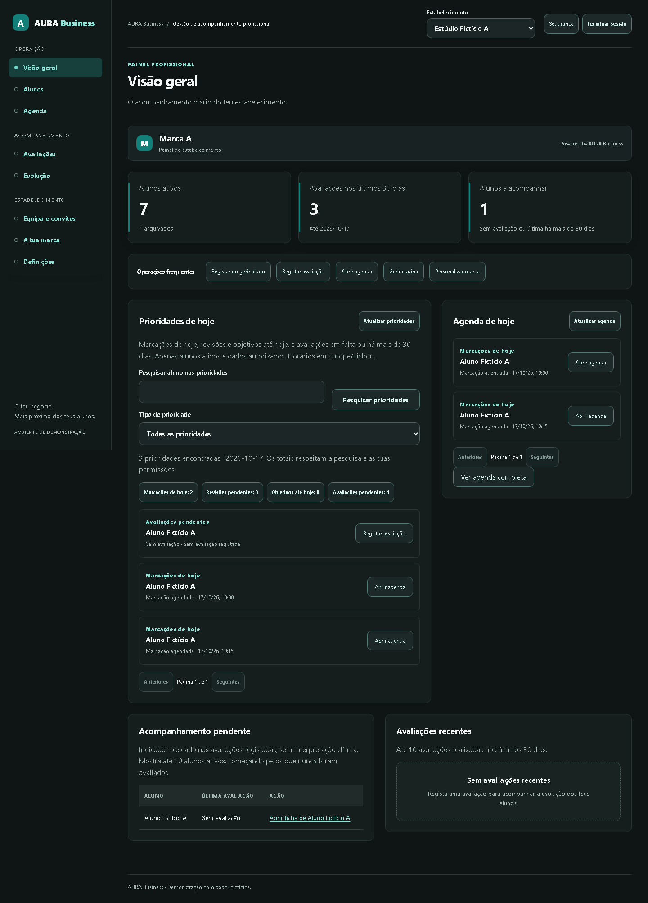
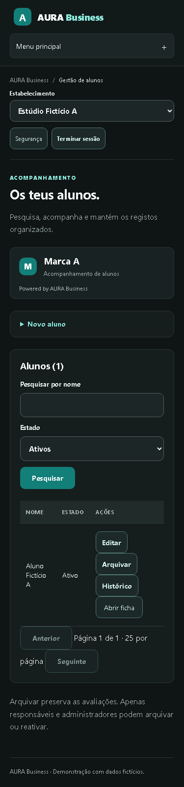
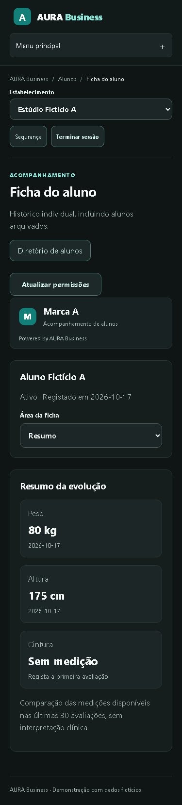

# Validação UI/UX Premium — entrega para revisão

Base: `saas-foundation` / `c248203e7ecb41289cf455c2f720d27be8314359`.
Estrutura: PR #22 (`feat/aura-premium-navigation`). Refinamento: branch dependente `feat/aura-premium-operations`.

## Funcionalidades e evidências reproduzíveis

| Alteração | Implementação | Verificação |
|---|---|---|
| Sidebar com oito módulos e mobile recolhível | `components/AppNavigation.tsx` | `e2e/premium-navigation.spec.cjs` |
| Breadcrumbs, seletor único e sessão | `components/ProfessionalShell.tsx`, páginas profissionais | teste desktop, menu por Enter e skip link |
| Evolução e Definições reutilizam áreas existentes | `app/evolucao/page.tsx`, `app/definicoes/page.tsx` | consulta sem escrita, competências ausentes para coach |
| Acompanhamento e privacidade fora do resumo | `components/AssessmentWorkspace.tsx` | teste de separação e cancelamento de rascunhos |
| Áreas da ficha adaptadas ao mobile | `components/ProfileNavigation.tsx` | seletor com nove áreas autorizadas e cancelamento de mudança |
| KPIs antes das ações; agenda independente | `components/DashboardOverview.tsx`, `components/DailyPriorities.tsx` | filtro das prioridades não altera as duas marcações fictícias |
| Diretório centrado na lista | `app/alunos/page.tsx` | criação recolhível, rascunho retido ao recolher/reabrir |
| Layouts desktop/mobile | `app/workspace.css` | `e2e/premium-visual.spec.cjs`: seis páginas, 375 e 1440 px |

Os testes existentes de revisões, revogação, respostas fora de ordem, proveniência NutriTrack, conflitos, reload/fecho/Voltar, teclado e permissões foram preservados. Apenas os percursos para os formulários deslocados e o menu mobile mudaram nos testes correspondentes.

A revisão detetou uma regressão intermédia: a regra de navegação mobile da ficha atingia também a demonstração pública, que partilha o nome da classe. A regra foi limitada a `.aura-workspace`; o percurso mobile da demonstração mantém o seu próprio comportamento. Os testes profissionais de importação, objetivos e privacidade passaram a operar o seletor mobile, mantendo as mesmas verificações de rascunhos e dados.

## Comandos

Executar em `commercial/`, com Node 22.23.3 e dependências bloqueadas:

```sh
npm run check
npm audit --audit-level=low
npm run test:e2e -- --workers=2
```

`check` valida domínio/PostgreSQL (PGlite), TypeScript e build. A suite normal Chromium usa fixtures que interceptam Supabase; não executar runners históricos desativados nem definir `AURA_E2E_LIVE`. Não houve nova execução Auth/PostgREST cloud nesta entrega de apresentação.

Os logs e capturas completas ficam em `.aura-integration/`, excluídos do Git. A seleção de capturas abaixo contém apenas nomes, medidas e marcações fictícias. A revisão visual verificou hierarquia, legibilidade, ausência de cortes da página, disposição da agenda, conteúdo da ficha e descoberta das áreas no mobile. Foi identificado e corrigido o corte da navegação horizontal da ficha; o mobile usa agora seletor nativo.

## Capturas selecionadas







## Limites e prioridades seguintes

- A aprovação técnica e esta revisão visual não substituem a avaliação por PT/estúdio nem testes manuais com leitores de ecrã e dispositivos físicos. Safari/Firefox não foram ensaiados nesta entrega.
- A atividade do dashboard continua limitada às avaliações recentes disponíveis no contrato existente; não existe feed universal de atividade nem métricas financeiras inventadas.
- As secções da ficha usam URLs com `section`, preservando os links existentes. Não foram criados contratos de dados ou migrations para a remodelação.
- Há CSS histórico partilhado com a demonstração pública. A camada estrutural do workspace foi isolada; a eliminação integral desse legado permanece uma refatorização separada, com revisão visual própria.
- Confirmar o candidato num staging isolado com Auth real antes de qualquer integração/publicação futura. Nenhum serviço foi atualizado nesta entrega.
- Bloqueios altos continuam abertos: passwords comprometidas, política de sessões/JWT, recuperação operacional cloud, recuperação completa de conta/MFA e requisitos jurídicos/retenção. Ver os documentos operacionais existentes. Não há autorização para piloto comercial ou dados reais.
